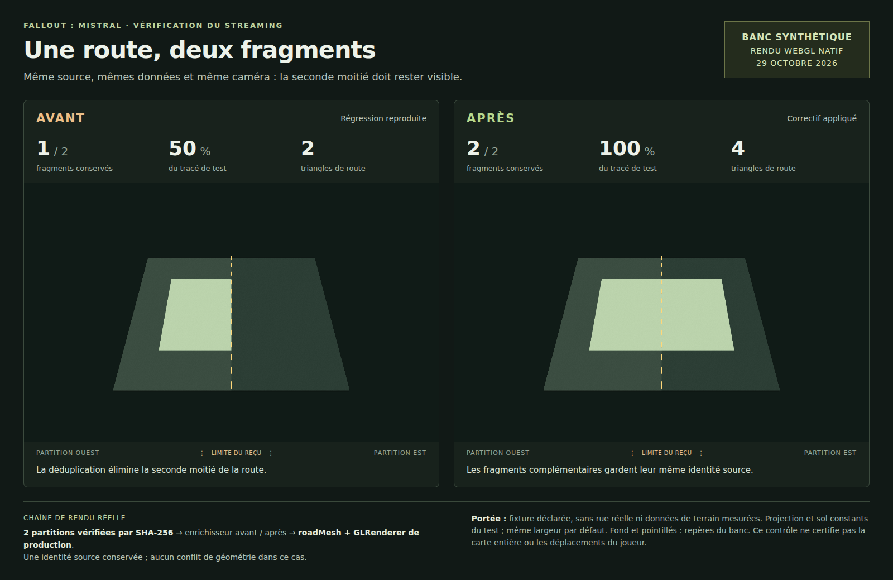
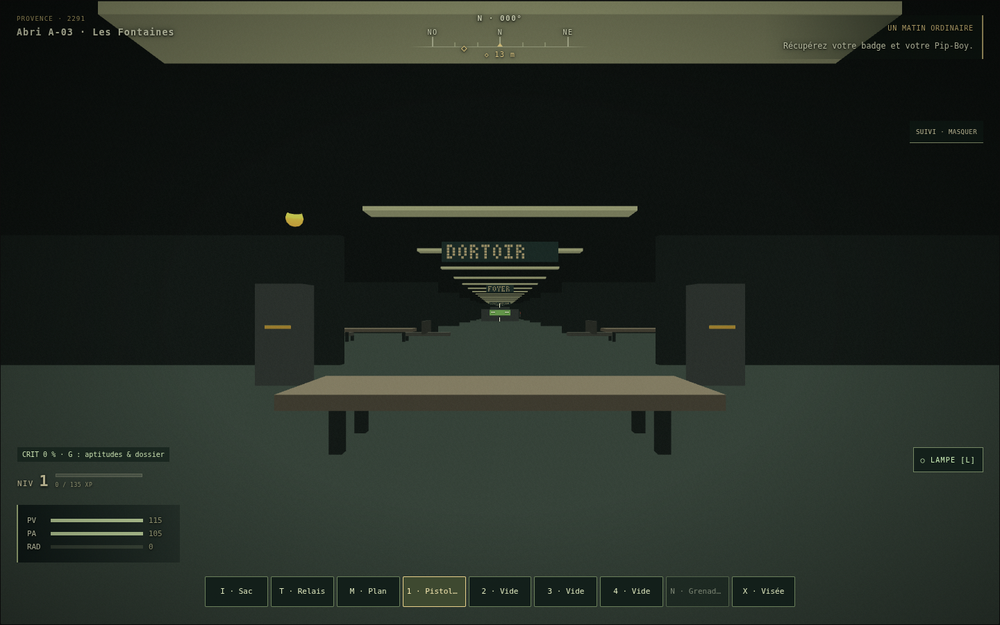
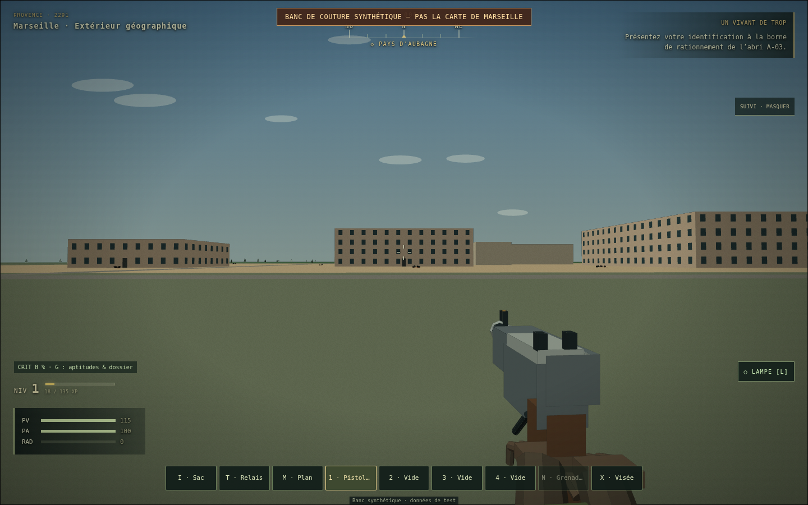
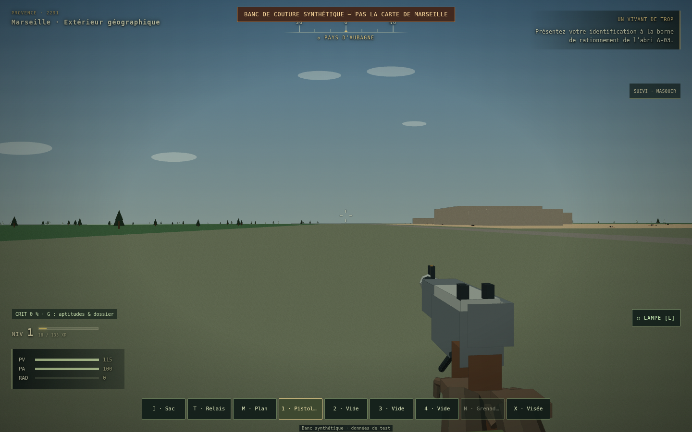

# Fallout : Mistral — routes continues et livraison synchronisée

**29 octobre 2026 — lot de corrections sur la v0.50.**

Branche : `feature/gamedev-skills-integration`. Base examinée : `5cfe4fcdc82bfbc5370024f7a4ca324f34d722af`. Ce rapport accompagne la [PR nº 1](https://github.com/darknigthmare/fallout-Marseille/pull/1).

## Résultat

Une route présente dans deux partitions pouvait perdre sa deuxième portion visible. Le même identifiant et la même géométrie source complète étaient utilisés pour dédoublonner deux chemins pourtant découpés différemment par leurs reçus de couverture. Le correctif préserve les fragments complémentaires, conserve les identifiants et les données source, et continue d'éliminer les copies rendues identiques.

La sélection des partitions respecte également leur emprise rendue validée : elle comprend les bâtiments entiers, y compris au-delà de la zone de requête, ainsi que les routes effectivement couvertes. Les longues queues de route conservées dans les données brutes n'imposent plus le chargement de partitions distantes où elles ne sont pas rendues. Les anciens index sans `renderBbox` utilisent toujours leur emprise source.

Les fichiers jouables ont été reconstruits avec les corrections accumulées dans la branche. Le script de build ajoute un contrôle sans écriture, et le nom du cache hors ligne dépend maintenant de l'empreinte du HTML. Une modification des sources doit donc être accompagnée des fichiers réellement lancés par le joueur.

## Preuve visuelle du défaut corrigé



Cette image est une capture de Chromium utilisant les fonctions de production `roadMesh`, `GLRenderer` et leurs shaders. Les deux vues ont le même cadrage, la même couleur et les mêmes entrées. Le module d'enrichissement précédent puis le module corrigé sont exécutés sur deux partitions synthétiques avec vérification SHA-256.

| Mesure de ce cas précis | Avant | Après |
| --- | ---: | ---: |
| Fragments conservés | 1 sur 2 | 2 sur 2 |
| Longueur en unités de la fixture | 4 | 8 |
| Triangles de route | 2 | 4 |
| Pixels de route dans la portion est, hors repère central | 0 | 68 991 |
| Conflits de géométrie source | 0 | 0 |
| Erreurs WebGL | 0 | 0 |

Les identifiants source restent identiques. Le résultat corrigé est stable après rechargement et inversion de l'ordre des partitions. Les unités de projection, le sol constant et les repères de cette image appartiennent au banc de test ; ce n'est pas une capture d'une rue réelle de Marseille.

[Résultats et empreintes du banc visuel](../verification/gamedev-streaming-2026-10-29/ROAD_VISUAL.json).

## Jeu reconstruit réellement exécuté



Le fichier HTML de production est servi sans modification par un serveur HTTP local, puis son empreinte est comparée au fichier reconstruit. La campagne démarre dans l'abri A-03 avec le moteur WebGL. Le stockage du navigateur est isolé du stockage d'un joueur.





Le laboratoire existant est explicitement marqué comme synthétique dans le jeu. Le parcours vérifie un déplacement natif avec les collisions, le chargement d'une fenêtre voisine, le retour à la fenêtre initiale et la conservation des géométries : cinq bâtiments et deux routes avant et après. Il vérifie aussi que le laboratoire n'écrit pas dans la sauvegarde de campagne. Aucun remplacement du HTML de production ni interception des requêtes du navigateur n'est utilisé pour ce parcours.

[Résultats du parcours navigateur](../verification/gamedev-streaming-2026-10-29/BROWSER_SMOKE.json).

## Contrôles exécutés

| Vérification | Résultat |
| --- | --- |
| Suite historique de streaming communal, avec nouvelle régression | 20 tests réussis |
| Géographie et import des sources | 50 tests réussis |
| Contact des routes avec le terrain, dont fixture de référence du Vieux-Port | 6 tests réussis |
| Géométries denses et calculs d'emprise | 8 contrôles réussis |
| Annulation d'attente, identités géométriques et sélection des partitions | 3 suites réussies ; l'annulation comporte 5 contrôles |
| Parcours du HTML de production dans Chromium | 12 contrôles réussis, 0 exception JavaScript |
| Comparaison visuelle native de la route divisée | 13 contrôles réussis |
| Installation, activation et navigation hors ligne du service worker | 6 contrôles réussis |
| Build et syntaxe des fichiers exécutables | Réussite |

Les comptages de tests, contrôles et suites correspondent à leurs outils respectifs ; ils ne sont pas additionnés en un pourcentage de complétude du jeu. Les commandes, sorties et codes de retour sont conservés dans [UNIT_REGRESSIONS.json](../verification/gamedev-streaming-2026-10-29/UNIT_REGRESSIONS.json).

### Livraison et cache hors ligne

`python3 tools/build_single.py --check` compare les octets de quatre fichiers : `src/game.js`, `index.html`, `JOUER_FALLOUT_MISTRAL_v0.50.html` et `sw.js`. Il ne les réécrit pas. Une modification temporaire de source a été introduite puis retirée pour vérifier que les quatre désynchronisations sont détectées et que le contrôle laisse les fichiers intacts. [Preuve de ce contrôle](../verification/gamedev-streaming-2026-10-29/BUILD_GUARD.json).

La vérification GitHub s'exécute avant toute reconstruction et lance maintenant la suite historique de streaming, en complément des trois petites suites ciblées. Elle détecte donc les fichiers jouables oubliés et les régressions déjà couvertes par les tests existants.

Le test du cache installe d'abord un ancien écran synthétique avec la stratégie de cache du jeu, puis publie le worker et le HTML courants sur le serveur de test. Il attend la fin de l'activation, vérifie le contenu exact du cache courant et la suppression de l'ancien, puis recharge le jeu hors ligne. Une donnée géographique absente reste une erreur explicite ; elle n'est pas remplacée par du HTML. [Résultats du cache](../verification/gamedev-streaming-2026-10-29/SERVICE_WORKER.json).

Une page déjà ouverte conserve son JavaScript jusqu'à son rechargement. Après mise à jour des fichiers du jeu, recharger la page permet d'utiliser le nouveau programme.

## Reproduire

Depuis la racine d'un checkout de la branche :

```sh
python3 tools/build_single.py --check
node --check src/game.js
node tests/expansion/city_streaming.cjs
node tests/expansion/city_wait_cancel.test.cjs
node tests/expansion/city_partition_seams.test.cjs
node tests/expansion/city_geometry_identity.test.cjs
node tests/expansion/geography.test.cjs
node tests/expansion/ground_road_surfaces.cjs
node tests/expansion/dense_geometry.cjs
```

Avec Playwright Node et Chromium déjà disponibles localement :

```sh
node tests/expansion/city_delivery_browser.cjs
node tests/expansion/service_worker_delivery.cjs
node tests/expansion/city_road_visual.cjs
```

`CHROMIUM_PATH` peut sélectionner un navigateur installé. Les deux premiers scripts acceptent `MISTRAL_PLAYWRIGHT_MODULE` pour le paquet Node ; le banc visuel accepte `PLAYWRIGHT_MODULE`. Aucun de ces scripts ne télécharge un navigateur. Le banc avant/après nécessite le commit de base `5cfe4fcdc82bfbc5370024f7a4ca324f34d722af` dans l'historique Git ; `MISTRAL_BASELINE_REF` permet de sélectionner un équivalent vérifié.

Environnement exécuté : Node 24.22.1, Python 3.12.14, Chromium 153.0.8010.0 avec ANGLE/SwiftShader. L'exécution a utilisé un espace temporaire en mémoire après saturation du disque partagé. Cela n'apporte aucune mesure de performances sur GPU matériel.

## Portée et suite du chantier

Ce lot corrige un défaut reproductible de fragments routiers et vérifie la livraison du programme corrigé. Il ne certifie pas chaque raccord, collision, rue ou intérieur de la commune. Le parcours navigateur emploie le laboratoire synthétique existant ; les archives géographiques métropolitaines n'ont pas été restaurées dans ce snapshot de validation. Le rapport navigateur énumère les ressources optionnelles absentes.

Le prochain contrôle géographique reste un parcours de raccords avec les archives réelles installées, puis une vérification des bâtiments et collisions sur ces limites. Les tests automatisés et les captures présentes ne remplacent pas un playtest humain prolongé.

La méthode applique les principes de conservation du moteur, de séparation entre données et rendu, et de déterminisme du [router gamedev](https://github.com/gamedev-skills/awesome-gamedev-agent-skills/blob/main/router/SKILL.md) et du [guide procedural-gen](https://github.com/gamedev-skills/awesome-gamedev-agent-skills/blob/main/skills/disciplines/procedural-gen/SKILL.md), adaptés aux sources géographiques existantes. Aucune nouvelle géographie mesurée n'a été inventée.
